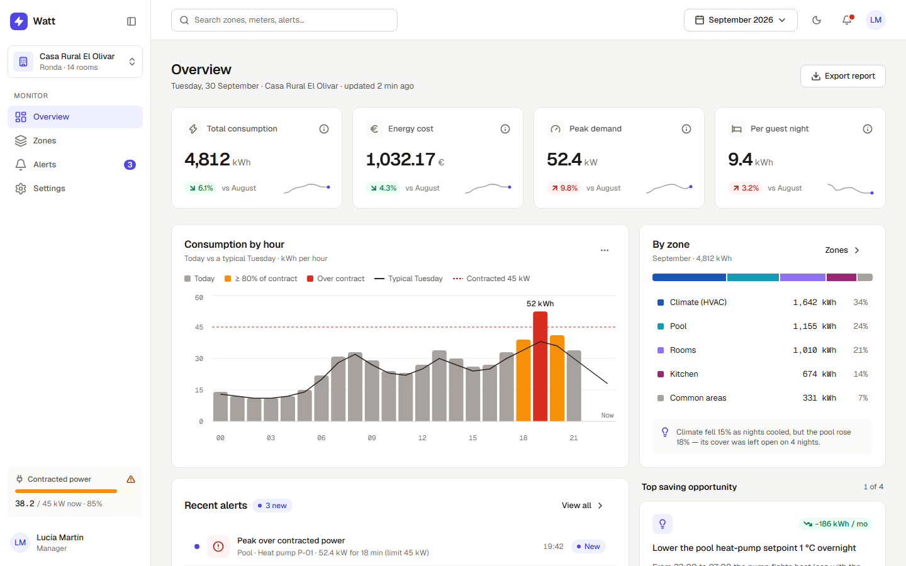
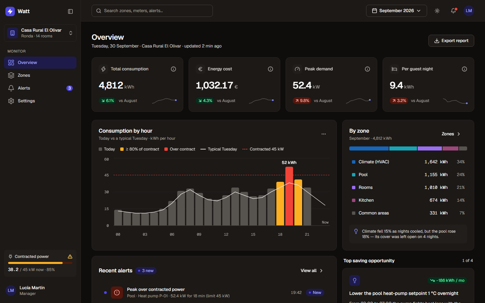
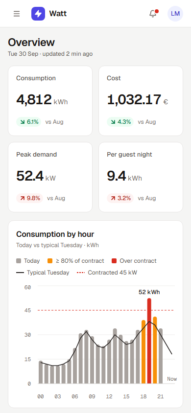
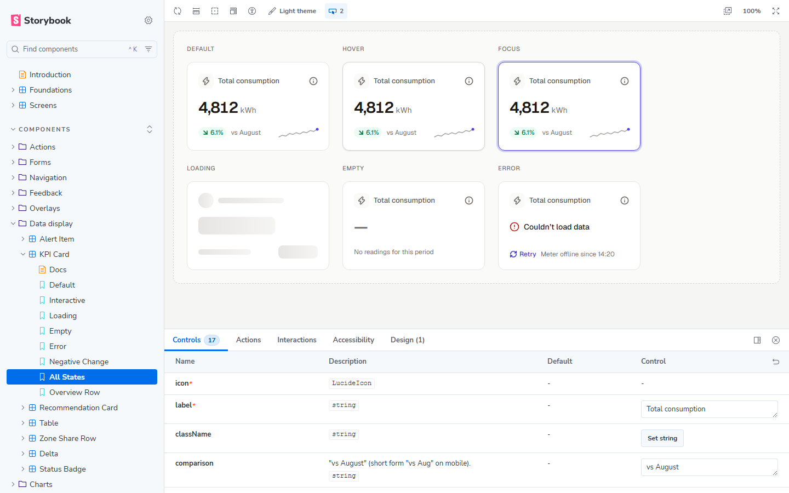

<a href="https://watt-energy.netlify.app"></a>

# Watt — energy dashboard, from Figma to code

An energy-consumption dashboard for small hotels and rural houses: what each zone of the building consumes, what it costs, when it peaks against the contracted power, and what to do about it.

**[Live app ↗](https://watt-energy.netlify.app)** · **[Storybook ↗](https://watt-energy.netlify.app/storybook/)** · **[Figma file](https://www.figma.com/design/xRB9FSPYbdup5v6rJz4R9F/Dashboard---Watt)** · Built by [Javier Piedra](https://jpiedra.com/en/)

> Concept project. Designed in Figma and built as a React app on a documented component library. The data comes from a realistic mock API.

| Dark theme | Mobile | Storybook |
| --- | --- | --- |
|  |  |  |

## Overview

A small hotel's electricity bill says how much it spent, not where or when. Watt breaks consumption down by zone (rooms, kitchen, climate control, pool), shows peaks against the contracted power, raises alerts and suggests savings.

The component library is the core of the project: every component set on the Figma _Components_ page has a Storybook entry with all its states, including loading, empty and error.

## Highlights

- **Component library.** 159 stories. Each Figma component set has an _All states_ story laid out like the grid on the Figma page; Hover, Focus and Pressed are forced with the pseudo-states addon. The _Design_ tab of each story opens the matching Figma node, and the accessibility addon runs on every story.
- **Five screens.** Overview, Zones, Zone detail, Alerts and Settings, in light and dark, from 390 px to wide desktop. Storybook also shows each screen in its loading, error and empty states.
- **A mock backend.** [MSW](https://mswjs.io) serves three months of plausible data with realistic latency in the browser, in production too, so skeletons and error states show up for real.
- **Shareable views.** Filters, sorting, paging, selection, period and chart range live in the URL.

## Tech stack and decisions

| Concern | Choice |
| --- | --- |
| UI | React 19, TypeScript (strict), Vite 8 |
| Styling | Tailwind CSS v4, with the theme generated from the Figma variables |
| Accessible primitives | Radix UI (dialog, dropdown menu, select, tabs, tooltip, switch, checkbox, toggle group) |
| Charts | Recharts |
| Table | TanStack Table (manual sorting, filtering and pagination; the API does the work) |
| Routing and URL state | TanStack Router, with search params validated by Zod |
| Server state | TanStack Query |
| Forms | React Hook Form + Zod |
| Mock API | MSW 2 (service worker in the browser, `msw/node` in tests) |
| Component docs | Storybook 10 (docs, a11y, themes, pseudo-states, designs, msw addons) |
| Tests | Vitest, Testing Library, axe-core |
| Icons and fonts | Lucide, Geist and Geist Mono |

### Where state lives

| State | Where | Why |
| --- | --- | --- |
| Data from the API | TanStack Query | Caching, retries, `keepPreviousData` while paging, optimistic updates with rollback |
| Filters, sorting, page, selection, period, chart range, tabs | The URL, validated with Zod | Shareable and bookmarkable; survives reloads; invalid values fall back to defaults |
| Theme and collapsed sidebar | React context + `localStorage` | Per-device preferences; the theme is applied before first paint |
| Forms (settings, zone, thresholds) | React Hook Form + Zod | Field-level errors, error summary, a "leave without saving?" guard |

## Accessibility and performance

The target is WCAG 2.2 AA.

- **Keyboard.** A skip link, then sidebar, top bar and content in a logical order. Every control is reachable and operable by keyboard. On navigation, focus moves to the page `<h1>`. Press `/` to focus the global search, which follows the ARIA combobox pattern. Dialogs, menus, selects and tooltips are Radix, so focus is trapped and returned, Esc closes, and arrow keys move.
- **Charts.** Each chart is one `role="img"` with a written summary of the key figures, plus a _Show data table_ button that appears on keyboard focus and reveals the real data table. Colour is never the only cue: there are legends, a dashed line for the contracted power, and labelled peaks. Series colours come from the `chart/*` tokens.
- **Contrast.** Checked with axe-core on the five screens in light and dark, at 1440 px and 390 px: 0 violations. See the note on `text/tertiary` under [Differences from the Figma file](#differences-from-the-figma-file).
- **Also:** `prefers-reduced-motion` turns off animations; status is spelled out for screen readers (`Critical:`, "up 9.8 %"); the table sets `aria-sort` and has a caption; loading buttons announce `aria-busy`; toasts use live regions (polite for success and info, assertive for warnings and errors; F8 jumps to them).
- **Theme without flash.** The theme follows the OS until the user picks one; the choice is applied by an inline script before the first paint.

## Getting started

You need Node 22.18 or later: the token script runs TypeScript natively.

```bash
npm ci
npm run dev          # app on http://localhost:5173
npm run storybook    # component library on http://localhost:6006
```

| Script | What it does |
| --- | --- |
| `npm run dev` | App with hot reload and the mock API |
| `npm run storybook` | Storybook in dev mode |
| `npm run build` | Type-check, then build the app into `dist/` |
| `npm run build:storybook` | Build Storybook into `dist/storybook/` |
| `npm run build:all` | Both builds (this is what Netlify runs) |
| `npm run preview` | Serve `dist/` locally: the app at `/`, Storybook at `/storybook/` |
| `npm run tokens` | Regenerate the CSS variables from `tokens/figma-variables.json` |
| `npm test` | Run the Vitest suite once (`npm run test:watch` to keep it running) |
| `npm run lint` · `typecheck` · `format` | ESLint (incl. jsx-a11y strict), `tsc -b`, Prettier |

---

## Architecture

```
src/
├── app/            Shell and wiring: router, URL search schemas, query client, preferences
│                   (theme, collapsed sidebar), AppShell, demo controls
├── api/            Data layer: Zod schemas, fetch client, query options and mutations
├── mocks/          MSW handlers, latency/error scenarios and the in-memory database
│   └── db/         Catalogue (property, zones, prices), deterministic generator, seed
├── components/
│   ├── ui/         Design-system primitives: Button, Input, Select, Tabs, Modal, Toast…
│   ├── data/       Data display: KpiCard, Table, AlertItem, RecommendationCard…
│   ├── charts/     Hourly consumption, history and zone breakdown, plus the accessible chart frame
│   └── layout/     Sidebar, NavItem, Topbar, global search, page and card chrome
├── routes/         One folder per screen; Screens.stories.tsx renders them in Storybook
├── lib/            Formatting, dates, zone helpers, media queries
├── stories/        Foundations, introduction and story helpers
├── styles/         tokens.css and theme.css (generated) and index.css
└── test/           Test setup and render helpers
```

Each story sits next to its component (`Button/Button.tsx` + `Button/Button.stories.tsx`). Components never import from `routes/` or `app/`, so the library stays independent of the app.

### Data layer

`src/api/client.ts` makes plain `fetch` calls to `/api/*`. In development and in tests every response is parsed with the Zod schema in `src/api/schemas.ts`, so the mock and the types can't drift apart. `src/api/queries.ts` exposes `queryOptions` factories and mutation hooks; components never build query keys by hand.

Swapping the mock for a real backend comes down to not starting MSW in `src/app/main.tsx` and pointing the client at the real base URL.

## Design tokens

```
Figma variables ──(Plugin API export)──▶ tokens/figma-variables.json ──npm run tokens──▶ src/styles/tokens.css
                                                                                      └─▶ src/styles/theme.css
```

1. **Export from Figma.** The Figma Variables REST API is Enterprise-only, so [`scripts/figma/export-variables.js`](scripts/figma/export-variables.js) reads the variables, text styles and effect styles inside the file with the Plugin API. Run it through the Figma MCP `use_figma` tool or a scratch plugin, then save the JSON to `tokens/figma-variables.json`.
2. **Generate CSS.** [`scripts/build-tokens.ts`](scripts/build-tokens.ts) writes:
   - `tokens.css`: primitives on `:root` and the semantic _Theme_ collection once per mode, under `[data-theme="light"]`, `[data-theme="dark"]` and `prefers-color-scheme`.
   - `theme.css`: the Tailwind v4 `@theme`, which exposes **only semantic tokens** as utilities (`bg-surface`, `text-secondary`, `border-subtle`, `shadow-elevation-2`, `type-body-small`…). The default Tailwind palette is switched off, so a raw colour can't sneak in. The script stops if two tokens would produce the same utility.
3. **Light and dark.** The theme follows the OS until the user picks one in the top bar. The choice is stored per device and applied before the first paint, so there's no flash.

Spacing uses a 1px base, so `p-16` means 16px, matching the Figma values exactly.

## Mock API

Every endpoint lives in [`src/mocks/handlers.ts`](src/mocks/handlers.ts):

```
GET   /api/property                 GET   /api/alerts?status&zone&severity&cursor
GET   /api/overview?period          PATCH /api/alerts/:id
GET   /api/consumption/hourly       POST  /api/alerts/resolve
GET   /api/zones?q&status&type&trend&sort&page&size
GET   /api/zone-types/:type         GET   /api/recommendations
GET   /api/zone-types/:type/history?range
POST  /api/recommendations/:id/:action
GET   /api/settings · PUT /api/settings · GET /api/search?q
```

- **Data.** July, August and September 2026 for _Casa Rural El Olivar_ (11 zones, 24 meters), with hourly and daily readings. A seeded generator makes the data identical on every load. Monthly totals match the Figma numbers (4,812 kWh, a 52.4 kW peak, 9.4 kWh per guest night…), and the daily curves follow a September cool-down and a mid-month heat wave. The demo clock is fixed at **30 Sep 2026, 22:14**. The _12m_ chart range adds synthetic monthly totals before July.
- **Latency.** Log-normal, mostly 300–900 ms, with a tail up to about 2.6 s.
- **Demo controls.** Open the account menu, then _Demo controls…_, to change latency (fast, realistic, slow), inject errors (none, a random 15 %, all) or empty the data set. You can also add a URL parameter that is applied once and then removed:

  | Parameter | Effect |
  | --- | --- |
  | `?demo=slow` | 1.6–3.8 s per request, so the skeletons are easy to see |
  | `?demo=errors` | Every request returns 503, so every error state shows |
  | `?demo=flaky` | 15 % of requests fail; retry buttons recover |
  | `?demo=empty` | Empty data set |
  | `?demo=fast` · `?demo=reset` | Fast responses · back to defaults |

## URL state

Everything you'd want to share is in the URL. For example:

```
/zones?q=rooms&sort=change.asc&selected=rooms-floor-1,rooms-annex
/zones?size=10&page=2
/zones/pool?range=7d
/alerts?status=new&severity=critical
/overview?period=2026-08          ← the period is kept as you move between pages
```

Defaults are left out of the URL, so links stay short. The search box writes to the URL 300 ms after you stop typing. The row selection survives paging, so you can select zones on several pages and then compare them.

## Tests

```bash
npm test
```

Vitest + Testing Library + `msw/node` against the same handlers as the app, with no latency:

- UI primitives and data components (states, keyboard behaviour, ARIA)
- The Zones table: sorting, selection and paging reflected in the URL, shared links restoring filters, debounced search, clear filters, error and retry
- Alerts: optimistic status changes with rollback on failure, tabs
- Settings: validation messages and save
- An axe check on each of the five screens
- The mock dataset reproducing the Figma numbers

Any `console.error` or `console.warn` during a test fails it.

## Deploying to Netlify

[`netlify.toml`](netlify.toml) already configures everything. The app and Storybook deploy to one site:

1. Push this repository to GitHub.
2. In Netlify, choose **Add new site → Import an existing project** and pick the repository.
3. Keep the detected settings: build command `npm run build:all`, publish directory `dist`, Node 22.
4. Deploy. The app is at `/` and Storybook at `/storybook/`. A fallback rule serves the app routes, and the MSW worker is sent with `no-cache` so updates reach visitors.

> The Storybook **Design** tab embeds the Figma file. Visitors only see it if the file is shared as _Anyone with the link can view_; otherwise Figma answers 403 inside that panel.

## Differences from the Figma file

These differences from the Figma file are intentional:

| Where | Figma | Code | Why |
| --- | --- | --- | --- |
| Overview › Energy cost | € 1,032.75 | € 1,032.17 | The code adds up the zone costs; the Figma figure doesn't match its own zone table |
| Zone detail › Climate deltas | 15.0 % / 14.2 % | 15.1 % / 13.5 % | Computed from the same dataset as every other figure |
| Weekday names | 30 Sep 2026 is a "Tuesday" | Same | The real date is a Wednesday; the demo calendar follows the Figma file (see `weekdayIndex` in `src/lib/format.ts`) |
| `text/tertiary` on canvas, hover and selected backgrounds | Tertiary | Secondary | Tertiary measures 4.39:1, 4.24:1 and 3.79:1 there, below AA. Suggestion: darken the token in Figma |
| Overview › By zone card | Content overflows the card bottom | 20 px bottom padding kept | Same padding as every other card |
| Zones table › Share bar | Fixed fill | Fill proportional to the share | The bar should encode the value |
| Recommendation › Applied note | "Applied 2 Oct" | "Applied 28 Sep" | 2 Oct is after the demo's "now" (30 Sep) |
| Hourly chart vs monthly totals | Hourly values and monthly totals imply different scales | Today's hourly profile is the Figma one; monthly totals are scaled separately | Keeps both charts identical to the design |
| Theme toggle in dark mode | Moon | Sun | The icon shows the theme you switch _to_ |
| Mobile | Overview only | Every screen | The other screens extend the Overview mobile patterns: a drawer for navigation, stacked cards, a scrollable table with a sticky first column |

---

Designed and built by **[Javier Piedra](https://jpiedra.com/en/)** — WordPress, 3D web and accessible front-ends. Need your Figma file turned into a working app? [Get in touch](mailto:javierpiedraiglesias@gmail.com).
